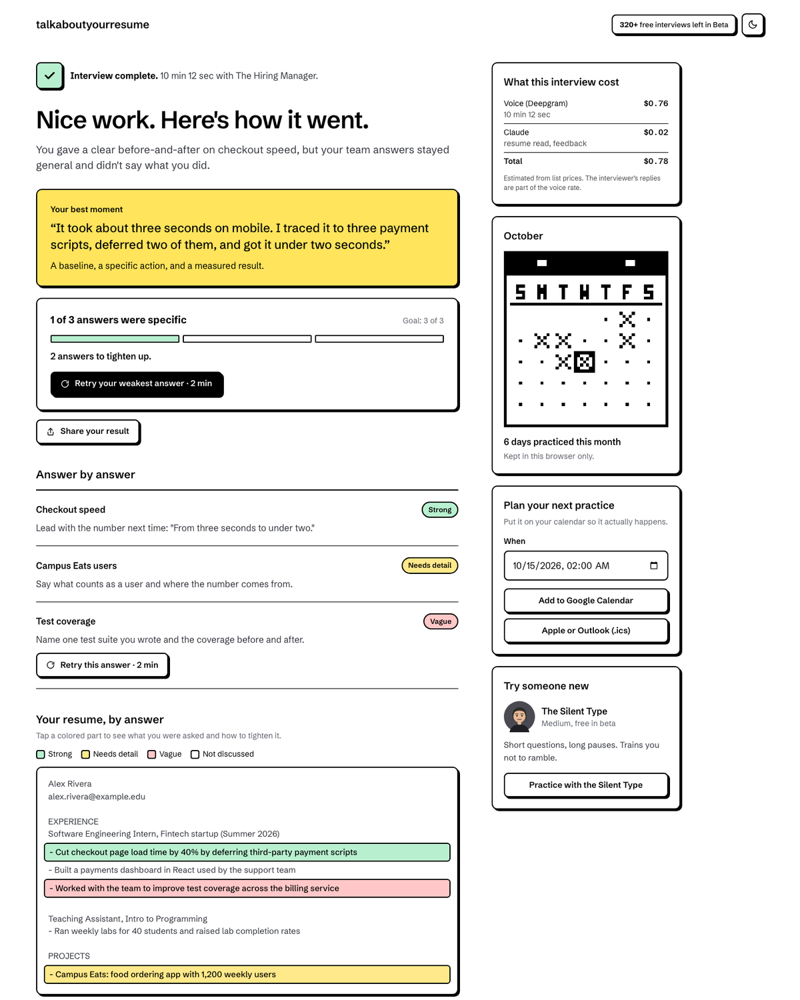
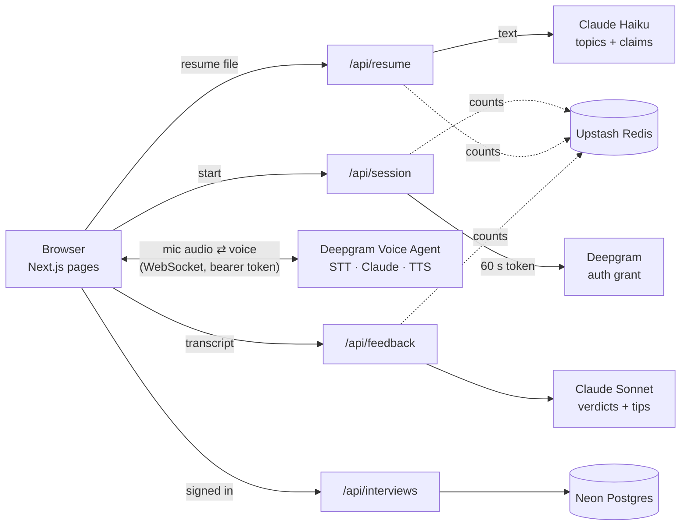

# talkaboutyourresume

**Practice talking about stuff you've done.** Upload your resume, and an AI interviewer asks about what you actually wrote, out loud, with the follow-up questions real interviewers ask: *what was it before, how did you measure that, what did **you** do?* Then see which answers held up.

**Live:** [talkaboutyourresume.vercel.app](https://talkaboutyourresume.vercel.app) · free during the beta, no account needed


## How it works

1. **Upload** a PDF or DOCX resume. Claude reads it into 4–7 interview topics, each with what a sharp interviewer would probe.
2. **Set up** the interview: choose what to practice (your resume plus your own questions, just your resume, or general behavioral questions), pick one of six interviewers from The Friendly One to The Griller, and optionally add practice questions with how you'd answer them.
3. **Talk.** A live voice interview of up to 15 minutes, in the browser. Pause to think mid-sentence without being cut off, interrupt, ask for a moment, turn on captions or your camera.
4. **Get feedback.** Every answer is judged Strong, Needs detail or Vague with one concrete tip. Compare what you said with what you planned, retry your weakest answer in a 2-minute session, see your resume colored by how each line held up, dig into Stats for nerds, and replay or download the recording.

| Set up | Interview |
|---|---|
|  |  |

<details>
<summary><b>Results page</b></summary>



</details>

## Features

- **Follow-ups that dig in.** After every answer the interviewer checks for a concrete example, numbers with a starting point, what *you* did, and the result, and asks for exactly the missing piece; "I don't remember" gets one ask for a ballpark. Topics and openings are randomized so no two interviews match.
- **Three interview modes:** resume + your own questions, just your resume, or general behavioral questions (failure, conflict, deadlines, initiative…) answered from your own experience.
- **Planned answers:** write how you'd answer a practice question; afterwards see the points you said, the ones you left out, and a tighter version built only from your own facts, with `[brackets]` where a number is missing. The interviewer never sees your plan.
- **Six interviewer personalities**, each with its own voice, speed, greeting and patience (`lib/interviewers.ts`).
- **Natural turn-taking:** Deepgram Flux decides from what you're saying whether you're done, so a thinking pause mid-sentence doesn't hand the turn to the interviewer. Barge-in: start talking and the interviewer stops.
- **A real ending:** when time is up, the app makes the interviewer ask for your questions, answer briefly and say goodbye, instead of being cut off mid-question.
- **Feedback that's specific:** verdict and tip per answer, your best line quoted, the first sentence a weak answer should have had, and a retry of your weakest answer.
- **Resume heatmap:** your resume text with every discussed claim colored by its verdict. Tap one for the question and tip.
- **Filler words** ("um", "you know", "basically", "like,") counted per answer and per minute, under Stats for nerds, and highlighted in the transcript.
- **Stats for nerds:** measured speaking pace, talk time and share, answer lengths, "I" vs "we", hedges, numbers mentioned, and the interviewer's response time split into speech-to-text, model and voice.
- **Optional accounts** (Google sign-in): each interview's score and feedback saved to a profile with a progress chart.
- **Share card and calendar invite:** a 1080 × 1080 result image, and a Google Calendar or .ics invite for the next practice.
- **Live cost:** what each interview costs in voice minutes and Claude tokens.
- **1-bit design** with a canvas-drawn pixel room, light and dark themes, keyboard and screen-reader friendly, reduced motion respected.

## Architecture



- **The server never sees your audio.** `/api/session` exchanges the Deepgram key for a token that expires in 60 seconds; the browser opens the voice WebSocket with it directly. The real key never leaves the server.
- **Reliable JSON from Claude.** `askJson` in `lib/claude.ts` has Claude answer by calling a tool whose input schema is the exact shape needed, so routes get parsed, typed objects.
- **Gapless, interruptible audio.** An AudioWorklet (`public/mic-processor.js`) turns the mic into 16 kHz PCM off the main thread; replies are scheduled back to back on the audio clock and all stop at once on barge-in.
- **The app drives the flow; the model words it.** Told to "wrap up", the model kept digging (0 of 4 closed in tests), so the app makes the interviewer say the closing line at the next pause (`InjectAgentMessage`) and adds closing rules (`UpdatePrompt`, which appends); a goodbye line is the fallback. One Settings builder (`lib/agentSettings.ts`) serves the app and the evals.
- **Untrusted input stays data.** Resumes, practice questions and planned answers are wrapped in tags and marked as data in every prompt; every model output is validated and capped before use.

## Measuring the interviewer

`npm run eval` runs full interviews between the real interviewer, through Deepgram's Voice Agent with production settings, and Claude playing seven candidate types (strong, vague, all "we", rambler, evasive, confused, adversarial) across three fictional resumes; a judge model scores every transcript and cites the turn. Details in [evals/README.md](evals/README.md).

| Check | Old prompt | Now |
|---|---|---|
| Closes properly (asks for their questions, says goodbye) | 15% | **100%**, without the fallback |
| Turns with more than one question | 24.5% | **0%** |
| Praise or verdicts mid-interview, per interview | 5.85 | **0.87** |
| Follows up on vague answers* | 61.9% | **74.3%** |
| Ignores injected instructions | 100% | 100% |

\* Re-scored with the newer, repeatable judge (Sonnet 4.6 at temperature 0); the other rows use the earlier judge. Single runs vary by about ±10 points.

`npm run eval:pauses` speaks a real answer with a thinking pause into a session and checks for interruptions:

| Speech-to-text | 2.5 s thinking pause | Reply after you finish |
|---|---|---|
| Nova-3 (before) | cut in after ~1 s | ~1 s |
| **Flux, threshold 0.9 (now)** | **waits, one turn** | ~1.7 s |

The evals also found Deepgram behaviors worth knowing: `UpdatePrompt` appends rather than replaces; a single message over ~1,000 characters is dropped and the model gets an empty request; sessions with no incoming audio are closed (the app now streams silence while you're muted).

## Data and privacy

| Data | Where it lives | Lifetime |
|---|---|---|
| Resume text, transcript, feedback, planned answers, voice measurements | The browser tab (`sessionStorage`) | Until the tab closes |
| Interview audio | Browser memory | Until refresh |
| Saved interviews (signed in): score, verdicts, tips, summary, best line | Neon Postgres | Until you delete them or your account |
| Daily usage counts, recent upload types and sizes | Upstash Redis | 400 days / last 500 |
| Waitlist emails | Upstash Redis | Until deleted |

Resume text, transcripts and planned answers go to Anthropic, and mic audio to Deepgram, only to run the session. No transcripts, resumes or audio are ever saved server-side. The plain-language version is at [/privacy](https://talkaboutyourresume.vercel.app/privacy).

## Tech stack

| Layer | Choice |
|---|---|
| App | Next.js 15 (App Router), React 19, TypeScript, plain CSS |
| AI | Claude via the Anthropic SDK: Haiku reads resumes, Sonnet writes feedback |
| Voice | Deepgram Voice Agent: Flux speech-to-text with semantic end-of-turn, Claude Haiku as the interviewer, Aura-2 voices |
| Resume parsing | `unpdf` (PDF.js) for PDF, `mammoth` for DOCX |
| Accounts | Clerk (Google sign-in) |
| Database | Neon Postgres for saved interviews; Upstash Redis for limits, counts and emails |
| Hosting | Vercel, with Web Analytics |

## Run it locally

Requires Node 20+, and Chrome with headphones for the voice interview.

```bash
npm install
cp .env.example .env.local   # then add ANTHROPIC_API_KEY and DEEPGRAM_API_KEY
npm run dev                  # http://localhost:3000
```

Only the two API keys are required. Everything else switches itself off when its variables are missing: no Clerk keys means no sign-in, no Upstash means no limits or counts, no `DATABASE_URL` means nothing is saved.

```bash
npm run typecheck   # TypeScript
npm run build       # production build
npm run eval        # interviewer evals: simulated candidates + a judge model (see evals/README.md)
npm run eval:pauses # turn-taking: does a thinking pause get cut in on? (Deepgram only)
```

## Environment variables

| Variable | Required | What it's for |
|---|---|---|
| `ANTHROPIC_API_KEY` | Yes | Resume reading and feedback |
| `DEEPGRAM_API_KEY` | Yes | The voice interview (needs Member access in Deepgram) |
| `ANTHROPIC_RESUME_MODEL`, `ANTHROPIC_FEEDBACK_MODEL`, `DEEPGRAM_THINK_MODEL` | No | Model overrides; defaults in `.env.example` |
| `MAX_INTERVIEW_MINUTES`, `DAILY_INTERVIEWS_PER_IP` | No | Session length (15) and per-IP daily limit (3) |
| `NEXT_PUBLIC_CLERK_PUBLISHABLE_KEY`, `CLERK_SECRET_KEY` | No | Google sign-in and profiles (added by the Clerk integration) |
| `CLERK_WEBHOOK_SIGNING_SECRET` | No | Deletes saved interviews when an account is deleted |
| `DATABASE_URL` | No | Saved interviews (added by the Neon integration) |
| `UPSTASH_REDIS_REST_URL`, `UPSTASH_REDIS_REST_TOKEN` | No | Limits, usage counts, waitlist. The Vercel integration's `*_KV_REST_API_URL` / `_TOKEN` names also work |
| `STATS_KEY` | No | Password for the private `/stats?key=…` page |
| `DEEPGRAM_PROJECT_ID`, `DEEPGRAM_BILLING_API_KEY` | No | The "N free interviews left" badge |

## Deploy on Vercel

1. Import the repo in Vercel. The framework is detected automatically.
2. Add `ANTHROPIC_API_KEY` and `DEEPGRAM_API_KEY`.
3. From the Vercel Marketplace, connect **Upstash for Redis**, **Neon** and **Clerk** to the project. Each adds its own environment variables. Or from the CLI: `vercel integration add neon` and `vercel integration add clerk`.
4. In Clerk: turn on Google, and add a webhook to `https://<your domain>/api/clerk-webhook` for `user.created` and `user.deleted`; put its signing secret in `CLERK_WEBHOOK_SIGNING_SECRET`.
5. Set `STATS_KEY` and turn on Web Analytics in the project's Analytics tab.
6. Before sharing publicly, set spending limits in the Deepgram and Anthropic consoles.

Every push to `main` deploys to production; every pull request gets a preview URL. The database table is created on first use; there's no migration step.

## Project structure

```
app/
  page.tsx                Home: pixel-room hero, example answers, pricing
  setup/page.tsx          Resume card, interview mode, interviewer picker, practice questions + planned answers, live preview
  interview/page.tsx      Full-window call: lobby, mic check, camera, captions, wrap-up timers
  feedback/page.tsx       Verdicts, retry, planned vs said, heatmap, fillers, stats for nerds, share, cost, calendar, save
  profile/page.tsx        Saved interviews and progress (signed in)
  stats/page.tsx          Private usage funnel (STATS_KEY)
  privacy/page.tsx        Plain-language privacy
  api/resume              PDF/DOCX → text → Claude → topics, claim ids, usage
  api/session             Limits, Deepgram token, interviewer prompt and voice settings
  api/feedback            Transcript (+ planned answers) → Claude → verdict per answer, best moment, planned vs said
  api/interviews          Save or delete the signed-in user's interviews
  api/clerk-webhook       Account created / deleted
  api/track, api/waitlist, api/deepgram-balance
lib/
  prompts.ts              Interviewer prompt, modes, follow-up rules, closing lines   ← tune the interviewer here
  interviewers.ts         The six personalities, voices, greetings, patience          ← and here
  agentSettings.ts        Deepgram Settings (Flux listening, model, voice), shared by the app and the evals
  claude.ts               Anthropic client, askJson (structured output via a tool call)
  voice/agent.ts          Browser side of the Deepgram WebSocket: mic, playback, barge-in, recording, the close, timings
  db.ts                   Neon: interviews table, save, list, delete
  limits.ts               Upstash: daily limits, usage counts, uploads, emails
  heatmap.ts, fillers.ts  Resume heatmap placement, filler-word patterns
  nerdStats.ts            Stats for nerds: pace, talk share, I vs we, response times
  cost.ts, config.ts      Live cost ledger; BETA flag, limits and prices   ← update prices here
  store.ts                sessionStorage wrapper for the in-progress interview
components/               UI pieces: PixelScene, AudioPlayer, ResumeHeatmap, PlannedAnswers, StatsForNerds, ...
evals/                    Interviewer evals (simulated candidates, judge, results) and the pause check
public/mic-processor.js   AudioWorklet: mic → 16 kHz PCM
middleware.ts             Clerk session (pass-through without keys)
```

## Costs

Deepgram's Voice Agent is about **$0.075 a minute**, which includes the interviewer's Claude Haiku replies. A full 15-minute interview is about **$1.13**, plus about $0.02 of Claude for reading the resume and writing feedback. Rates live in `COST_RATES` in `lib/config.ts`, and the app shows the running total during each interview.

## Known limitations

- The 15-minute cap is enforced in the browser; a modified client could keep a voice session open. Cap spend in the Deepgram console.
- Daily limits are per IP address, which a campus network shares.
- Thinking pauses of 4 seconds or more can still be cut in on; the interviewer then says "take your time".
- Deepgram drops a single typed message over ~1,000 characters; whether very long nonstop speech hits the same limit is unverified.
- The interviewer has an eval suite (`npm run eval`), but there are no automated tests for the routes or feedback-quality evals yet.

## Roadmap

- Pro plan with Stripe (`BETA` in `lib/config.ts` keeps everything free until then)
- Daily limits per account instead of per IP
- Track the same resume topic across interviews ("checkout speed: Vague → Strong")
- Questions tailored to a pasted job description
- Per-question patience (`UpdateListen`) and resume keyterms for more accurate transcripts
- A site-wide response-time card on `/stats`, from the per-interview measurements
- Route tests, error tracking and an eval set for the feedback verdicts
