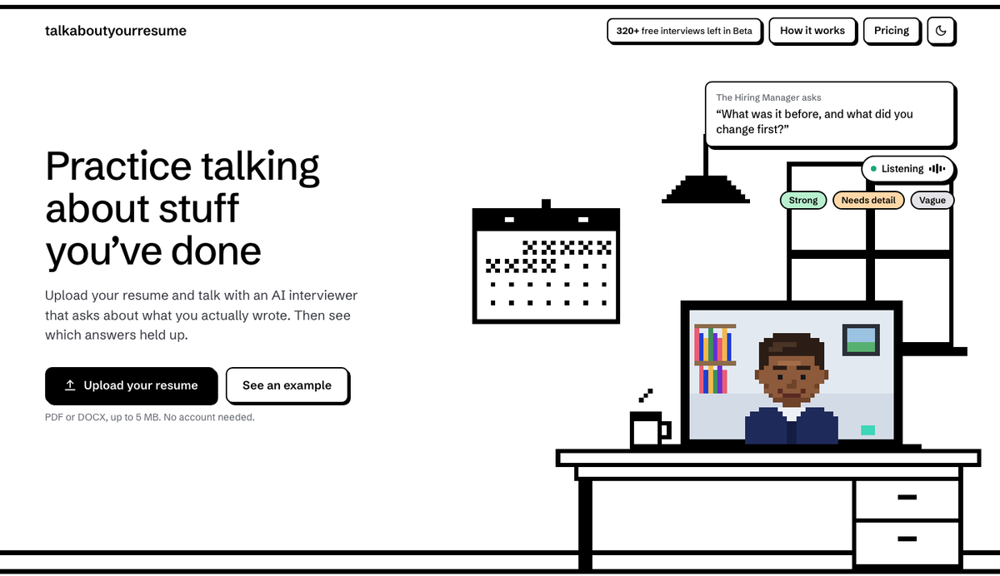
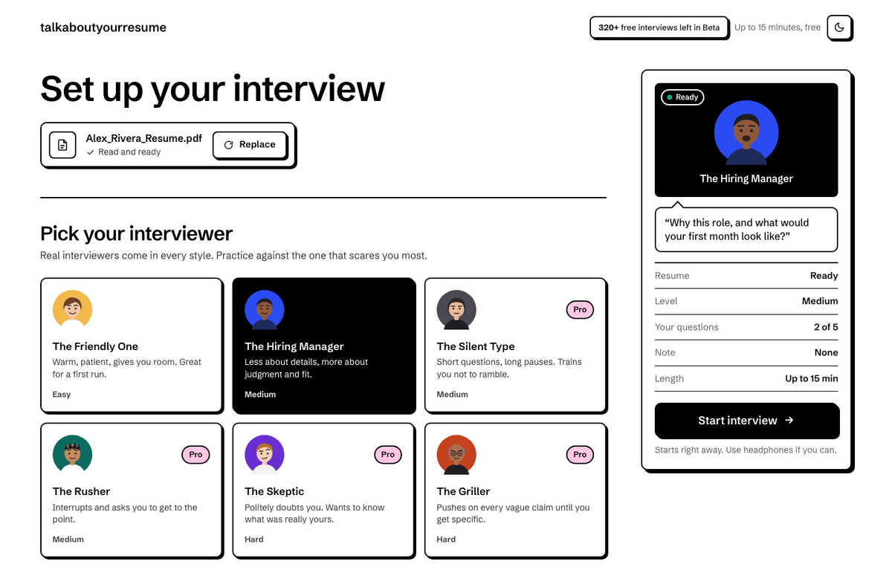
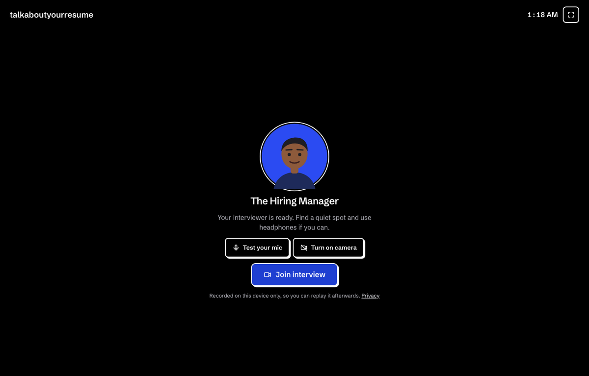
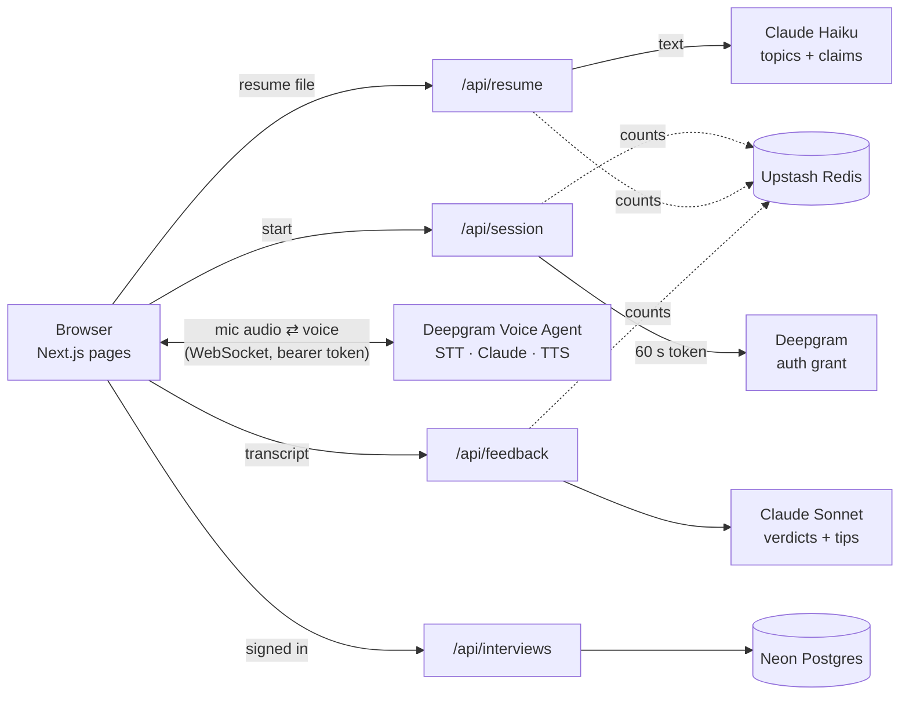

# talkaboutyourresume

**Practice talking about stuff you've done.** Upload your resume, and an AI interviewer asks about what you actually wrote, out loud, with the follow-up questions real interviewers ask: *what was it before, how did you measure that, what did **you** do?* Then see which answers held up.

**Live:** [talkaboutyourresume.vercel.app](https://talkaboutyourresume.vercel.app) · free during the beta, no account needed



## How it works

1. **Upload** a PDF or DOCX resume. Claude reads it into 4–7 interview topics, each with what a sharp interviewer would probe.
2. **Set up** the interview: pick one of six interviewers, from The Friendly One to The Griller, and optionally add questions you want to practice and anything you want to tighten up.
3. **Talk.** A live voice interview of up to 15 minutes, in the browser. You can interrupt, ask for a moment, turn on captions or your camera.
4. **Get feedback.** Every answer is judged Strong, Needs detail or Vague with one concrete tip. Retry your weakest answer in a 2-minute session, see your resume colored by how each line held up, and replay or download the recording.

| Set up | Interview |
|---|---|
|  |  |

<details>
<summary><b>Results page</b></summary>


</details>

## Features

- **Follow-ups that dig in.** The interviewer prompt is a rulebook: ask for the baseline behind any number, how it was measured, what *you* did when you say "we", one concrete example when vague. Topics and openings are randomized so no two interviews match.
- **Six interviewer personalities**, each with its own voice, speed and greeting (`lib/interviewers.ts`).
- **Real-time voice** with barge-in: start talking and the interviewer stops. Wraps up on time with a natural goodbye.
- **Feedback that's specific:** verdict and tip per answer, your best line quoted, the first sentence a weak answer should have had, and a retry of your weakest answer.
- **Resume heatmap:** your resume text with every discussed claim colored by its verdict. Tap one for the question and tip.
- **Filler words** ("you know", "basically", "like,") counted per answer and per minute.
- **Optional accounts** (Google sign-in): each interview's score and feedback saved to a profile with a progress chart.
- **Share card and calendar invite:** a 1080 × 1080 result image, and a Google Calendar or .ics invite for the next practice.
- **Live cost:** what each interview costs in voice minutes and Claude tokens.
- **1-bit design** with a canvas-drawn pixel room, light and dark themes, keyboard and screen-reader friendly, reduced motion respected.

## Architecture



- **The server never sees your audio.** `/api/session` exchanges the Deepgram key for a token that expires in 60 seconds; the browser opens the voice WebSocket with it directly. The real key never leaves the server.
- **Reliable JSON from Claude.** `askJson` in `lib/claude.ts` has Claude answer by calling a tool whose input schema is the exact shape needed, so routes get parsed, typed objects.
- **Gapless, interruptible audio.** An AudioWorklet (`public/mic-processor.js`) turns the mic into 16 kHz PCM off the main thread; replies are scheduled back to back on the audio clock and all stop at once on barge-in.
- **Untrusted input stays data.** Resumes and practice questions are wrapped in tags and marked as data in every prompt; every model output is validated and capped before use.

## Data and privacy

| Data | Where it lives | Lifetime |
|---|---|---|
| Resume text, transcript, feedback | The browser tab (`sessionStorage`) | Until the tab closes |
| Interview audio | Browser memory | Until refresh |
| Saved interviews (signed in): score, verdicts, tips, summary, best line | Neon Postgres | Until you delete them or your account |
| Daily usage counts, recent upload types and sizes | Upstash Redis | 400 days / last 500 |
| Waitlist emails | Upstash Redis | Until deleted |

Resume text and transcripts go to Anthropic, and mic audio to Deepgram, only to run the session. No transcripts, resumes or audio are ever saved server-side. The plain-language version is at [/privacy](https://talkaboutyourresume.vercel.app/privacy).

## Tech stack

| Layer | Choice |
|---|---|
| App | Next.js 15 (App Router), React 19, TypeScript, plain CSS |
| AI | Claude via the Anthropic SDK: Haiku reads resumes, Sonnet writes feedback |
| Voice | Deepgram Voice Agent: Nova-3 speech-to-text, Claude Haiku as the interviewer, Aura-2 voices |
| Resume parsing | `unpdf` (PDF.js) for PDF, `mammoth` for DOCX |
| Accounts | Clerk (Google sign-in) |
| Database | Neon Postgres for saved interviews; Upstash Redis for limits, counts and emails |
| Hosting | Vercel, with Web Analytics |

## Run it locally

Requires Node 20+, and Chrome with headphones for the voice interview.

```bash
npm install
cp .env.example .env.local   # then add ANTHROPIC_API_KEY and DEEPGRAM_API_KEY
npm run dev                  # http://localhost:3000
```

Only the two API keys are required. Everything else switches itself off when its variables are missing: no Clerk keys means no sign-in, no Upstash means no limits or counts, no `DATABASE_URL` means nothing is saved.

```bash
npm run typecheck   # TypeScript
npm run build       # production build
```

## Environment variables

| Variable | Required | What it's for |
|---|---|---|
| `ANTHROPIC_API_KEY` | Yes | Resume reading and feedback |
| `DEEPGRAM_API_KEY` | Yes | The voice interview (needs Member access in Deepgram) |
| `ANTHROPIC_RESUME_MODEL`, `ANTHROPIC_FEEDBACK_MODEL`, `DEEPGRAM_THINK_MODEL` | No | Model overrides; defaults in `.env.example` |
| `MAX_INTERVIEW_MINUTES`, `DAILY_INTERVIEWS_PER_IP` | No | Session length (15) and per-IP daily limit (3) |
| `NEXT_PUBLIC_CLERK_PUBLISHABLE_KEY`, `CLERK_SECRET_KEY` | No | Google sign-in and profiles (added by the Clerk integration) |
| `CLERK_WEBHOOK_SIGNING_SECRET` | No | Deletes saved interviews when an account is deleted |
| `DATABASE_URL` | No | Saved interviews (added by the Neon integration) |
| `UPSTASH_REDIS_REST_URL`, `UPSTASH_REDIS_REST_TOKEN` | No | Limits, usage counts, waitlist. The Vercel integration's `*_KV_REST_API_URL` / `_TOKEN` names also work |
| `STATS_KEY` | No | Password for the private `/stats?key=…` page |
| `DEEPGRAM_PROJECT_ID`, `DEEPGRAM_BILLING_API_KEY` | No | The "N free interviews left" badge |

## Deploy on Vercel

1. Import the repo in Vercel. The framework is detected automatically.
2. Add `ANTHROPIC_API_KEY` and `DEEPGRAM_API_KEY`.
3. From the Vercel Marketplace, connect **Upstash for Redis**, **Neon** and **Clerk** to the project. Each adds its own environment variables. Or from the CLI: `vercel integration add neon` and `vercel integration add clerk`.
4. In Clerk: turn on Google, and add a webhook to `https://<your domain>/api/clerk-webhook` for `user.created` and `user.deleted`; put its signing secret in `CLERK_WEBHOOK_SIGNING_SECRET`.
5. Set `STATS_KEY` and turn on Web Analytics in the project's Analytics tab.
6. Before sharing publicly, set spending limits in the Deepgram and Anthropic consoles.

Every push to `main` deploys to production; every pull request gets a preview URL. The database table is created on first use; there's no migration step.

## Project structure

```
app/
  page.tsx                Home: pixel-room hero, example answers, pricing
  setup/page.tsx          Resume card, interviewer picker, practice questions, live preview
  interview/page.tsx      Full-window call: lobby, mic check, camera, captions, wrap-up timers
  feedback/page.tsx       Verdicts, retry, heatmap, fillers, share, cost, calendar, save
  profile/page.tsx        Saved interviews and progress (signed in)
  stats/page.tsx          Private usage funnel (STATS_KEY)
  privacy/page.tsx        Plain-language privacy
  api/resume              PDF/DOCX → text → Claude → topics, claim ids, usage
  api/session             Limits, Deepgram token, interviewer prompt and voice settings
  api/feedback            Transcript → Claude → verdict per answer, best moment, weakest
  api/interviews          Save or delete the signed-in user's interviews
  api/clerk-webhook       Account created / deleted
  api/track, api/waitlist, api/deepgram-balance
lib/
  prompts.ts              Interviewer system prompt and follow-up rules   ← tune the interviewer here
  interviewers.ts         The six personalities, voices, greetings        ← and here
  claude.ts               Anthropic client, askJson (structured output via a tool call)
  voice/agent.ts          Browser side of the Deepgram WebSocket: mic, playback, barge-in, recording
  db.ts                   Neon: interviews table, save, list, delete
  limits.ts               Upstash: daily limits, usage counts, uploads, emails
  heatmap.ts, fillers.ts  Resume heatmap placement, filler-word patterns
  cost.ts, config.ts      Live cost ledger; BETA flag, limits and prices   ← update prices here
  store.ts                sessionStorage wrapper for the in-progress interview
components/               UI pieces: PixelScene, AudioPlayer, ResumeHeatmap, ShareResult, ...
public/mic-processor.js   AudioWorklet: mic → 16 kHz PCM
middleware.ts             Clerk session (pass-through without keys)
```

## Costs

Deepgram's Voice Agent is about **$0.075 a minute**, which includes the interviewer's Claude Haiku replies. A full 15-minute interview is about **$1.13**, plus about $0.02 of Claude for reading the resume and writing feedback. Rates live in `COST_RATES` in `lib/config.ts`, and the app shows the running total during each interview.

## Known limitations

- The 15-minute cap is enforced in the browser; a modified client could keep a voice session open. Cap spend in the Deepgram console.
- Daily limits are per IP address, which a campus network shares.
- "Um" and "uh" can't be counted: Deepgram's voice agent drops them.
- There are no automated tests or feedback-quality evals yet.

## Roadmap

- Pro plan with Stripe (`BETA` in `lib/config.ts` keeps everything free until then)
- Daily limits per account instead of per IP
- Track the same resume topic across interviews ("checkout speed: Vague → Strong")
- Questions tailored to a pasted job description
- Route tests, error tracking and an eval set for the feedback verdicts
